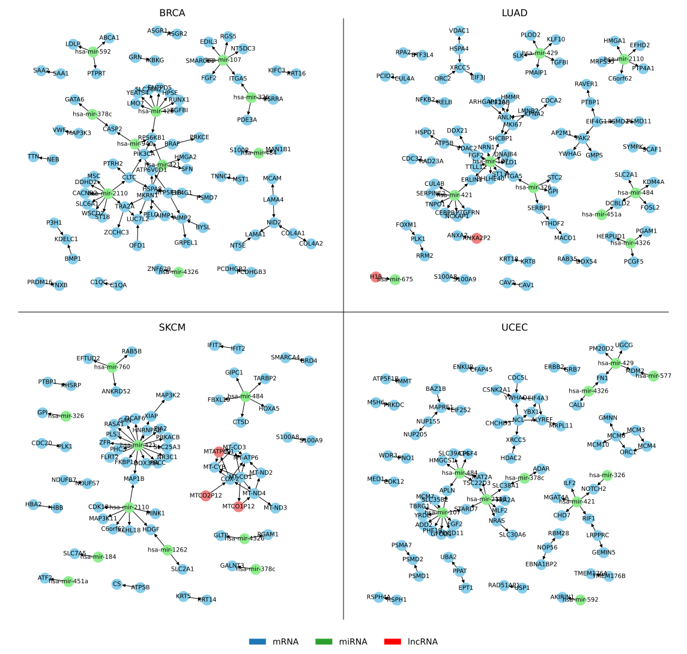
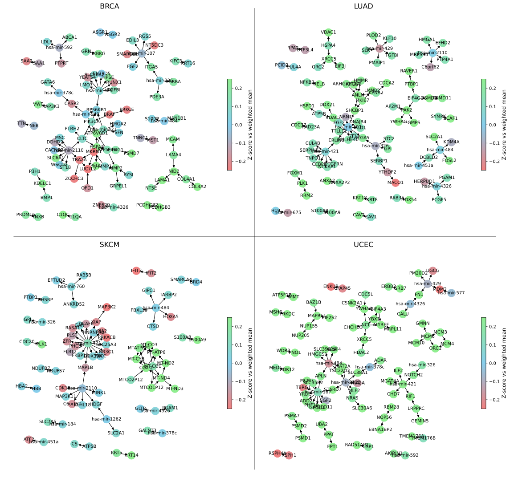

This is the repository of the **RNA Co-Regulatory Network Explorer and Classifier (RNACOREX)** package, developed in the DATAI institute of Universidad de Navarra. **RNACOREX** is a Python package for building Bayesian Network based classification models using post-transcriptional networks with heterogeneous RNA molecules. It uses curated interaction databases and conditional mutual information for identifying sets of interactions and models them using different continuous Bayesian network classifiers.

## 🚀 Features

- Extracts structural and functional scores from RNA interactions.
- Identifies post-transcriptional coregulation networks associated with different phenotypes.
- Supports interactions among mRNAs, miRNAs, and lncRNAs.
- Builds Bayesian network classifiers using RNA interaction sets.
- Models nonlinear dependencies using SPBNs and SLGBNs.
- Supports multiclass classification and partial inference.
- Visualizes post-transcriptional networks and maximum probability networks (MPNs).

## 📦 Installation

Until RNACOREX is available on PyPI, it can be installed locally from the root directory of the cloned repository:

```bash
python -m pip install -e .
```

> [!IMPORTANT]
> **Automatic Engine Setup:** When importing RNACOREX, the package automatically checks whether `interactions.parquet` is present in the required `Engine/` directory. If the file is missing, it will be downloaded automatically.

The engine can also be downloaded using the next command:

```bash
rnacorex.download()
```

Run the next command to check if the engines have been correctly added:

```bash
rnacorex.check_engines()
```

## ⚡ Quick Start

Run the `quickstart.py` script and `Quick_Start.ipynb` notebook in `quickstart` folder for easy applications of RNACOREX. Find data in `GPB/Data/` folder.

```python
from rnacorex import RNACOREX
import pandas as pd

# Load data

# Initialize model

rnacorex = RNACOREX(n_con=40)

# Fit model

rnacorex.fit(X_train, y_train)

# Load the network.

G = rnacorex.model_['G']

# Predict on new data

rnacorex.predict(X_test)

```

👉 **Note:** The input matrix must follow these ID formats:

- **mRNAs** should be identified using **Ensembl gene IDs** (e.g. `ENSG00000139618`) **without version numbers** (❌ `ENSG00000139618.12`).
- **miRNAs** should be named using **miRBase names in lowercase**, e.g. `hsa-mir-21` or `hsa-mir-125b-3p`.


## 🕸️ Network Visualization

RNACOREX provides functions to visualize the inferred post-transcriptional networks and their maximum probability counterparts.

### Raw Network

The inferred network can be visualized directly using `rnacorex.display()`:

```python
G = rnacorex.model_['G']

rnacorex.display(G)
```

**Output examples:**



### Maximum Probability Network

The maximum probability configuration can be obtained and visualized using `rnacorex.mpc()`.

```python
mpc = rnacorex.mpc(
    display=True,
    c=0,
    k=40,
    th=0.25
)
```

`c`: Class to visualize, compared with the global configuration.
`k`: Number of interactions to include.
`th`: Controls the sensitivity to deviations in node colors.

**Output examples:**




## How to cite?
